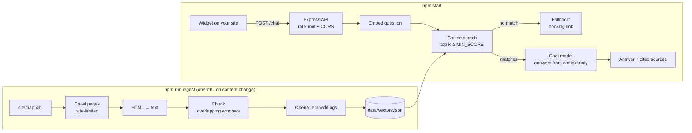

# AI Website Chatbot (RAG demo)

A small Node.js chatbot that **answers questions only from your own website**. It crawls your sitemap, splits the pages into chunks, embeds them with OpenAI and stores the vectors in a local JSON file. An Express `/chat` endpoint retrieves the closest passages and asks the chat model for a short answer **with citations**. When the site doesn't cover a question, the bot doesn't guess and offers your **booking link** instead.

Includes a tiny embeddable chat widget (one `<script>` tag).

> Built by [Meraz.Pro](https://meraz.pro) as a portfolio demo. Bring your own OpenAI key. No keys or client data are included.

## How it works



1. **Crawl:** reads `SITEMAP_URL` (and child sitemaps of a sitemap index), keeps up to `MAX_PAGES` URLs after include/exclude filters, and waits `CRAWL_DELAY_MS` between requests.
2. **Chunk:** about 220-word windows with a 40-word overlap (configurable).
3. **Embed and store:** vectors go to `data/vectors.json`, together with the embedding model name so a model mismatch is caught at startup.
4. **Answer:** the question is embedded, the top `TOP_K` chunks above `MIN_SCORE` are sent to the chat model with a strict "answer only from context, cite [n]" prompt. Only the cited sources are returned.

## Setup

Requirements: Node.js 20.6+ (for `--env-file`). On Node 18, export the variables yourself and run the scripts with plain `node`.

```bash
npm install
cp .env.example .env      # add OPENAI_API_KEY, SITEMAP_URL, BOOKING_URL, ALLOWED_ORIGINS
npm run ingest            # crawl + embed → data/vectors.json
npm start                 # API + demo at http://localhost:3001/demo.html
```

### Embed on a website

```html
<script src="https://your-chatbot-api.example.com/widget.js"
        data-api="https://your-chatbot-api.example.com"
        data-title="Ask us anything" defer></script>
```

On WordPress, paste it with Elementor Custom Code, a header/footer plugin or your theme. Add your site's origin to `ALLOWED_ORIGINS`.

### API

```http
POST /chat
Content-Type: application/json

{ "question": "How much does a website cost?" }
```

```json
{
  "answer": "New websites start from ... [1]",
  "sources": [{ "n": 1, "url": "https://example.com/pricing/", "title": "Pricing" }],
  "fallback": false
}
```

## Configuration

See [.env.example](.env.example). Highlights:

| Variable | Default | Purpose |
| --- | --- | --- |
| `EMBEDDING_MODEL` | `text-embedding-3-small` | Embedding model (re-run ingest after changing it) |
| `CHAT_MODEL` | `gpt-4o-mini` | Model that writes the answer |
| `MAX_PAGES` / `CRAWL_DELAY_MS` | 50 / 1000 | Crawl size and politeness |
| `TOP_K` / `MIN_SCORE` | 4 / 0.30 | How many passages, and how relevant they must be |
| `MAX_ANSWER_TOKENS` | 350 | Caps output length and cost |
| `RATE_LIMIT_PER_MINUTE` | 10 | Per-IP limit on `/chat` |
| `ALLOWED_ORIGINS` | – | Sites allowed to call the API from a browser |

## Cost control

You pay OpenAI per token. Small sites are cheap, but a public endpoint can be abused, so the demo has limits built in:

- **Ingest:** a one-off cost. The script logs an approximate token count before embedding. A 50-page site is usually well under 100k tokens, which costs a few cents or less with `text-embedding-3-small`.
- **Each question:** one tiny embedding plus one chat call, with about `TOP_K × 220` words of context and up to `MAX_ANSWER_TOKENS` of output. With a small model like `gpt-4o-mini` this is a fraction of a cent per answer.
- **Guards:** a per-IP rate limit, a 500-character question limit, a 10 kB body limit, a CORS allowlist and capped output tokens. Off-topic questions that match nothing never reach the chat model, so they skip the chat call entirely.
- **Recommended:** set a monthly **usage limit** in your OpenAI dashboard, and re-ingest only when content changes.

Prices change. Check [OpenAI pricing](https://openai.com/api/pricing/) before estimating a budget.

## Limits (it's a demo)

- The JSON vector store loads everything into memory. That's fine for a few thousand chunks. Use pgvector, SQLite-vec or a hosted vector DB beyond that.
- HTML-to-text is regex based. Pages rendered by JavaScript only won't have content.
- The rate limiter is in-memory. Use a shared store (such as Redis) if you run more than one instance.
- Respect the robots.txt and terms of any site you crawl. Crawl sites you own or have permission for.

## Testing

```bash
npm test
```

All OpenAI calls are mocked (a fake client plus `vi.mock('openai')`), and crawling uses a mocked `fetch`, so the tests are free and offline.

## License

MIT © Meraz.Pro. Want this on your site, connected to your calendar or CRM? Visit [meraz.pro](https://meraz.pro) or email [merazulislam90@gmail.com](mailto:merazulislam90@gmail.com).
